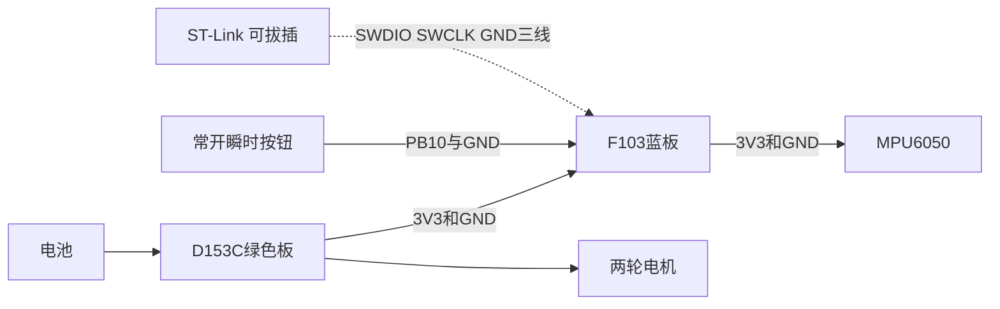

> 当前按钮操作（2026-11-12）已更新：停机长按0.8秒切换模式，无需断电；运行长按仍停机。PC13待机一闪=基本、两闪=避障。[最新按键与LED说明](按键与LED操作.md)。下文按钮操作按其历史版本理解，接线不变。

> P34接线沿用本页。按钮已改为短按平衡/任务/提前停车、长按0.8秒关闭电机；请以[目标二操作说明](目标二-五秒低速任务.md)为准。下文P31按键行为为旧版本记录。

# P31：独立供电、按钮启停与掉电参数

本方案采用已有的D153C V1.1辅助3V3电源，替换ST-Link供电。F103原供电点不变，只更换电源来源。先完成固件下载，再在全部断电时改线。

## 接线表

| 从哪里接 | 接到哪里 | 用途 |
|---|---|---|
| 绿色D153C的3V3输出 | F103原来接ST-Link电源的3V3/3.3V脚 | 主控供电；绿色板5V不接本方案 |
| 绿色D153C的GND | F103的GND | 电源回路及信号共地，已有地线保留 |
| 按钮一个独立触点 | F103的B10/PB10 | 按钮输入，固件内部上拉 |
| 按钮另一个独立触点 | F103的GND | 按下时PB10与GND导通 |
| ST-Link的SWDIO | F103的SWDIO/PA13 | 调参、下载时连接 |
| ST-Link的SWCLK | F103的SWCLK/PA14 | 调参、下载时连接 |
| ST-Link的GND | F103的GND | 调试共地 |

**ST-Link的3.3V和5V电源脚均不连接F103。** 不能把两个稳压电源输出并在一起；本次下载完成、改成绿色板供电后，应将原ST-Link电源线拔下并包好。SWD接头最好只装三根信号线，避免日后误插电源线。

本方案不同时接F103板载USB电源，不把电池12V、绿色板5V接到3V3脚。F103芯片供电范围为2.0～3.6V；绿色板辅助3V3此前空载读数为3.27V，改线后应核对实际带主控负载的电压。板载稳压器具体型号尚未确认，因此本方案不依赖F103的5V输入降压路径。[ST官方供电规格](https://www.st.com/en/microcontrollers-microprocessors/stm32f103c8)

绿色板J5辅助电源排针，资料对应前3组为3V3/GND、后3组为5V/GND。接线按实物丝印确认，避免正反面方向导致选错。F103照片中B10位于B11与B1之间，注意B10不是B1。IMU仍从F103的3V3供电，电机、编码器及PWM/方向/STBY接线保持原样。

## 按钮与安装

使用“松开断路、按下导通”的瞬时常开按钮，不使用自锁式电源开关代替它。若是四脚轻触开关，要选松开时不通、按下才通的一对脚；同一内部触点的两只引脚可能一直相通，不能把这一对当作开关。可以用万用表通断档确认。

按钮安装在车身上部、手扶时容易触及的位置，离开车轮与转动线材；两根细线固定在车身，留少量松弛，避免再次拖拽。内部上拉配20ms软件去抖，短距离接线不需要另购防抖模块。

- 上电保持停止；上电时一直按住按钮也不会启动，须先松开。
- 停止时按一下：进入3秒准备，板载PC13灯快闪。
- 准备结束时须松开按钮，车身在当前零点±2°内、姿态数据有效，才启动一个设定时长的窗口；不满足就取消，本次不自动重试。
- 准备中再按一下：取消准备。运行中再按一下：去抖确认后立即停止，灯熄灭。
- 运行时灯常亮。到时、超过±15°、数据失效时结束本次运行，不锁存、不自动重启。
- 按钮是软件启停，绿色板OFF仍用于直接断开供电。

新增加的±2°仅是启动准备的姿态条件，用来减少大倾角起步的追赶距离；运行中的真实倾角保护仍为±15°。

## 参数和面板怎么保留

1. **保存文件**：保存电脑的参数.ini；不改变车。
2. **应用到车**：停止时将面板参数应用到当前RAM；不启动。
3. **保存到车·掉电保留**：将车上当前参数写入Flash。面板显示“已保存”后，再断电也能恢复；显示“参数已改·待保存到车”时，应再按此按钮。

Flash采用两个独立1KB页交替保存、CRC校验、最后写入完成标记；中途写失败时保留上一份有效记录。相同参数重复保存不会重复擦写。存储在指定64KB范围内的最后两页，程序链接时预留，不依赖部分C8芯片额外报告的容量。参数存储不是保存电机运行状态；每次上电仍停止。[ST Flash编程说明](https://www.st.com.cn/resource/en/programming_manual/pm0075-stm32f10xxx-flash-memory-microcontrollers-stmicroelectronics.pdf)

本地网页和Node服务在电脑上，拔ST-Link不会关闭页面，输入值及电脑参数文件保留；离线遥测标为上次读数，不能继续在线改车。插回三线SWD并给主控供电后，面板自动重新连接、校验固件，只读取当前值，不复位、不自动启动、不自动应用电脑文件。运行时调参和保存会被拒绝，先按按钮停止再操作。

按钮启动的运行不依赖电脑心跳，拔下ST-Link后继续按设定窗口运行。电脑面板启动也由车上执行3秒准备；USB中断后电脑不能保证立即发送停止，离线用车上按钮或绿色板OFF停止。

点击“停止并断开”会停止并暂停自动连接，以便进入Keil；再次点击连接即可恢复。点击“停止并关闭服务”才会退出本地服务。若电脑服务已关闭，双击启动面板.cmd可重新打开。更新程序或重新烧写全片可能影响参数记录，升级前电脑INI应保留。

## 改线顺序

1. 下载及保存参数完成后，绿色板OFF、拔电池，再拔ST-Link USB，使蓝板也断电。
2. 移除原ST-Link到F103的3.3V电源线，并将裸露端绝缘。
3. 接绿色板3V3/GND到F103的3V3/GND，接按钮PB10/GND；SWD只保留三根信号线。
4. 先不按启动，恢复绿色板供电，确认F103电源灯亮、3V3电压正常、车轮不转。
5. 脱开整根ST-Link信号线，手扶车身接近面板定义的0°，按按钮，3秒后进行第一次脱线试验。
6. 调参时先停止、扶稳，再接回三线SWD。绿色板须给F103供电，ST-Link不再供电。

